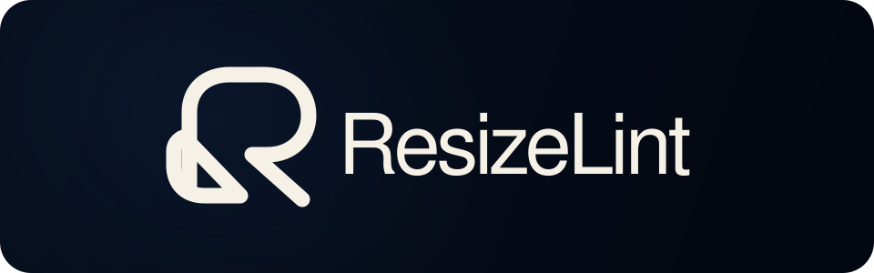
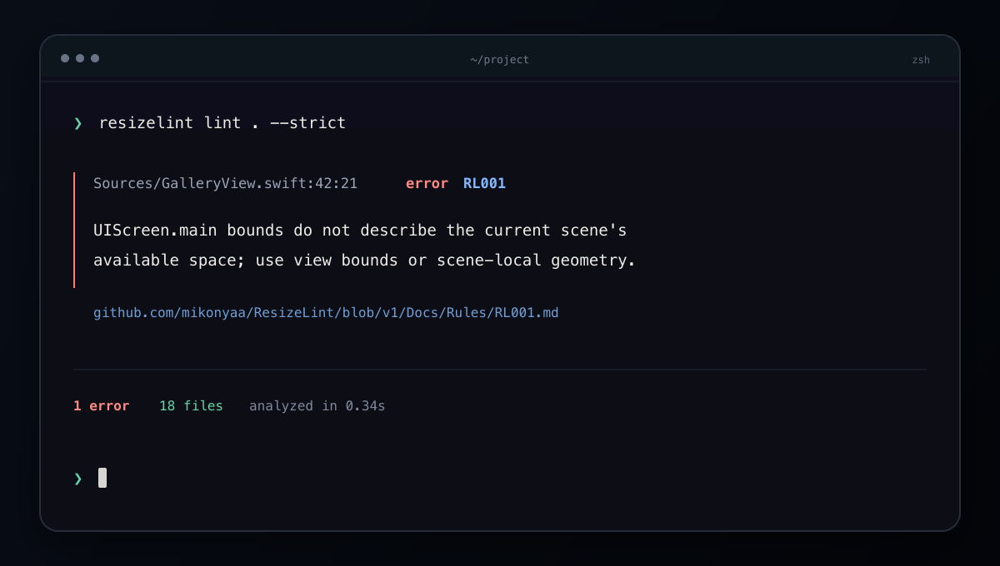
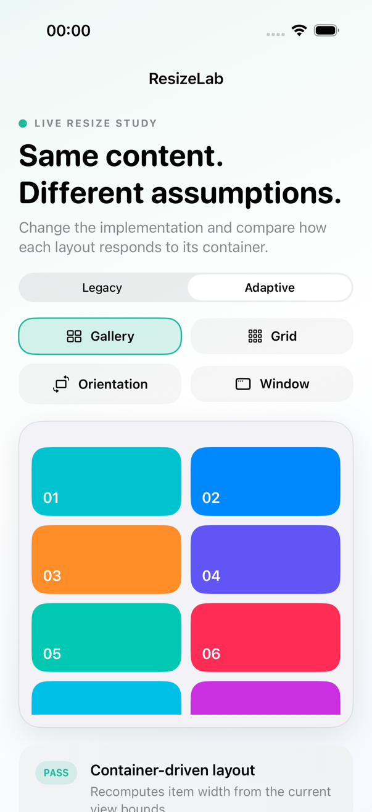

<p align="center">
  
</p>

<p align="center"><strong>Catch the UIKit assumptions that break resizable iPhone apps.</strong></p>

<p align="center">
  <a href="#installation">Install</a> ·
  <a href="#20-second-terminal-demo">See it run</a> ·
  <a href="Docs/Rules/README.md">Browse rules</a> ·
  <a href="Docs/CLI.md">CLI reference</a>
</p>

ResizeLint is a local static analyzer for Swift applications that must remain correct when the window no longer matches the physical device. It finds layout decisions built on process-global or device-shaped assumptions—such as `UIScreen.main` bounds, device idiom, interface orientation, and arbitrary global windows—and points to scene-local or container-driven alternatives.

It scans Swift source, property lists, and Xcode project metadata, then produces stable diagnostics for people and automation. Human and Xcode output make findings easy to fix locally; JSON and SARIF integrate with CI and code scanning. Analysis is deterministic, source stays on the machine, and ResizeLint has no daemon, account, telemetry, or cloud service.

This checkout is **1.0.1-rc.1**, a local release candidate addressing six consumer defects. See [candidate changes and verification](Docs/ReleaseCandidate.md). Publication, tap installation and notarized distribution require separate artifact evidence.

- **Focused:** nine high-confidence rules for UIKit geometry, scene lifecycle, and adaptive layout decisions.
- **Adoptable:** baselines, scoped suppressions, severity overrides, and one deliberately conservative safe fix.
- **Automation-ready:** stable rule IDs, reproducible ordering, machine-readable reports, and a checksum-verifying GitHub Action.

## Installation

The published Homebrew formula installs 1.0.0, not this candidate:

```bash
brew install mikonyaa/tap/resizelint
resizelint version
```

The existing signed macOS package is also the older `1.0.0` release. Its fixes and baseline behavior differ from this candidate:

```bash
curl -fLO https://github.com/mikonyaa/ResizeLint/releases/download/1.0.0/ResizeLint-1.0.0-macos-universal.pkg
sudo installer -pkg ResizeLint-1.0.0-macos-universal.pkg -target /
resizelint version
```

Build a candidate source checkout/archive with Swift 6.3.3:

```bash
cd ResizeLint-1.0.1-rc.1
swift build -c release
.build/release/resizelint version
```

The candidate targets macOS 14 or newer on Apple silicon and Intel, plus Ubuntu 22.04/24.04 on x86_64. Its Linux archive statically links Swift, Foundation and musl and requires no separately installed Swift runtime. The published 1.0.0 Linux archive requires Swift runtime libraries; use the verified candidate archive for a Swift-free environment.

Extract a local candidate archive into a private directory and run its executable directly:

```bash
shasum -a 256 -c SHA256SUMS
unzip ResizeLint-1.0.1-rc.1-macos-universal.zip -d local-resizelint
# Linux: tar -xzf ResizeLint-1.0.1-rc.1-linux-x86_64.tar.gz -C local-resizelint
./local-resizelint/resizelint version
./local-resizelint/resizelint lint . --format json
```

## 20-second terminal demo

```console
$ resizelint lint . --format xcode --strict
Sources/GalleryView.swift:42:21: error: [RL001] UIScreen.main bounds do not describe the current scene's available space; use view bounds or scene-local geometry.
Sources/GridViewController.swift:18:17: warning: [RL006] Choose layout from size classes or the actual container size, not the device idiom.
```



## Why resizing matters

A phone interface can appear in a window whose size, aspect ratio, and environment do not match the physical display. Code that asks “what device is this?” can therefore choose the wrong layout even though it compiled and looked correct in a full-screen simulator.

Adaptive code asks the container instead: view bounds for geometry, traits for presentation choices, and scene-local objects for windows and display context. ResizeLint detects the most consequential global assumptions and explains the narrower input that should replace each one. The same checks run locally, in Xcode, and in CI, so resizing regressions can be blocked before runtime QA.

ResizeLint does not rewrite app architecture and does not upload source. It can verify manual modernization work or changes produced by automated modernization tools.

## Rules

### Errors

- **RL001 · main-screen-bounds** — flags `UIScreen.main` bounds used as local layout geometry.
- **RL004 · global-window-access** — rejects arbitrary process-global current-window selection.
- **RL005 · global-status-bar-geometry** — replaces global status-bar geometry with scene-local context.
- **RL008 · legacy-app-lifecycle** — reports a proven app-level absence of scene lifecycle.

### Warnings

- **RL002 · main-screen-scale** — prefers trait or scene-local display scale.
- **RL003 · main-screen-reference** — catches remaining `UIScreen.main` dependencies.
- **RL006 · idiom-layout-decision** — finds phone/pad checks that drive layout.
- **RL007 · orientation-layout-decision** — finds orientation checks that drive layout.

### Review

- **RL009 · fullscreen-requirement-review** — requests a deliberate review of full-screen requirements.

See [the complete rule documentation](Docs/Rules/README.md) for detection boundaries and adaptive examples. Version 1.0.0 reached 100% error and warning precision on the documented [external validation corpus](Docs/ExternalCorpus.md).

## GitHub Action

The published moving tag `v1` currently uses the older release. Candidate Action changes remain local until separately published; the archive consumer checks its runner on macOS and Swift-free Linux:

```yaml
- id: resizelint
  uses: mikonyaa/ResizeLint@v1
  with:
    path: .
    config: .resizelint.yml
    fail-on: error
```

It downloads an exact release binary, verifies its SHA-256 checksum, writes SARIF, and exposes the report as `steps.resizelint.outputs.sarif`. The Action itself needs only `contents: read`; SARIF upload is a separate optional step with separate permissions. See [GitHub Action integration](Docs/GitHubAction.md).

## Configuration

Create a strict starter file:

```bash
resizelint init
```

```yaml
version: 1
include:
  - "**/*.swift"
  - "**/Info.plist"
  - "**/*.xcodeproj/project.pbxproj"
exclude:
  - ".build/**"
  - "Pods/**"
baseline: ".resizelint-baseline.json"
fail_on: error
rules:
  RL002:
    severity: warning
overrides:
  - files:
      - "Sources/Game/**"
    rules:
      RL009:
        enabled: false
```

Unknown keys and unknown rule IDs are errors. See [configuration reference](Docs/Configuration.md).

## Baseline

Adopt ResizeLint without accepting new debt:

```bash
resizelint baseline create .
resizelint lint .
resizelint baseline check .
resizelint baseline update .
```

Baseline v2 includes enclosing declarations and occurrence counts. Existing v1 users should run `resizelint baseline migrate .`; ambiguous/stale entries require review and are not automatically accepted. See [baseline behavior](Docs/Baselines.md).

## Safe fixes

`lint` never changes files. `fix` only applies the limited structural RL002 replacement `self.traitCollection.displayScale` in eligible instance bodies. Static/class members, nested declarations, closures and unknown receivers retain diagnostics without edits.

```bash
resizelint fix Sources --dry-run
resizelint fix Sources
```

Edits are checked for overlap, reparsed, written atomically, and verified by a second analysis pass. Permissions and line endings are preserved.

Reparsing is a syntax check; compile and test the application after fixing. Independent stub and native UIKit compilation cover the candidate's supported fix boundaries.

## ResizeLab

`Examples/ResizeLab` pairs legacy and adaptive implementations of the same gallery. It demonstrates screen-bound sizing, device-idiom grids, orientation branching, global window lookup, and scene-aware alternatives.

```bash
cd Examples/ResizeLab
xcodegen generate
open ResizeLab.xcodeproj
```

Run ResizeLab only in an iOS Simulator. Exercise compact, square, and wide windows, Dynamic Type, light and dark appearance, Reduce Motion, and Reduce Transparency.



See the [simulator QA evidence](Docs/ResizeLabQA.md) and the short [portrait-to-landscape resizing demonstration](Assets/resizelab-demo.mp4).

## Limitations

- Storyboard and XIB geometry are not analyzed.
- Broad SwiftUI fixed-frame heuristics are intentionally excluded from 1.0.
- Ambiguous target-to-plist relationships do not produce RL008 errors.
- The only automatic fix is the proven-safe RL002 instance-member case.
- Windows and Linux arm64 binaries are not part of 1.0.
- ResizeLint is static analysis; it does not perform runtime resize automation.

## Roadmap

Candidates for 1.1 include richer Xcode target mapping, `resizelint explain RL001`, Linux arm64, an incremental cache, and a local HTML report. Proposals must preserve deterministic output and high precision.

## Contributing, security, and license

Read [CONTRIBUTING.md](CONTRIBUTING.md) before changing a rule. False-positive changes need a minimized regression fixture and corpus evidence. Report sensitive problems through the process in [SECURITY.md](SECURITY.md). Community expectations are in [CODE_OF_CONDUCT.md](CODE_OF_CONDUCT.md). Maintainers can review the [1.0 verification evidence](Docs/Verification.md) and follow the [release preparation guide](Docs/ReleasePreparation.md) for protected signing and notarization readiness.

ResizeLint is available under the [MIT License](LICENSE).

ResizeLint is an independent open-source project and is not affiliated with or endorsed by Apple Inc.
